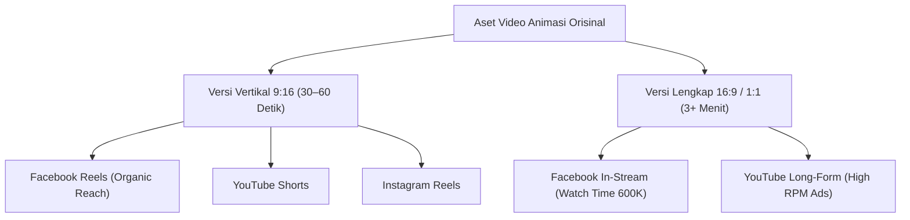

# 04. Publishing & Distribution — Wealth Blueprint

Dokumen ini mengatur strategi jadwal tayang berdasarkan zona waktu Amerika Serikat (dikonversi ke WIB), ritme mingguan, serta alur kerja distribusi lintas platform (*cross-posting workflow*).

---

## 1. Pemahaman Zona Waktu Amerika Serikat (US vs WIB)

Amerika Serikat memiliki 4 zona waktu utama. Sekitar **60% populasi US berada di zona Eastern (EST) dan Central (CST)**, sehingga jadwal rilis konten distandarisasi mengacu pada waktu EST:

```
┌───────────────────┬───────────────────┬────────────────────────────────┐
│ Zona Waktu US     │ Selisih Waktu     │ Konversi Contoh (9:00 AM Pagi) │
├───────────────────┼───────────────────┼────────────────────────────────┤
│ EST (Eastern)     │ WIB - 12 Jam      │ 21:00 WIB (Malam hari sama)    │
│ CST (Central)     │ WIB - 11 Jam      │ 22:00 WIB                      │
│ MST (Mountain)    │ WIB - 10 Jam      │ 23:00 WIB                      │
│ PST (Pacific/CA)  │ WIB - 9 Jam       │ 00:00 WIB (Tengah malam)       │
└───────────────────┴───────────────────┴────────────────────────────────┘
```

---

## 2. Jam Terbaik Penayangan Konten (Peak Engagement Windows)

Berdasarkan analisis perilaku pengguna Facebook di US, terdapat 3 jendela waktu interaksi tertinggi:

| Waktu US (EST) | Konversi Waktu Indonesia (WIB) | Alasan Perilaku Audiens |
|---|---|---|
| **9:00 – 11:00 AM EST** | **21:00 – 23:00 WIB** *(Slot Utama)* | Membuka media sosial sebelum mulai jam kerja kantor |
| **1:00 – 3:00 PM EST** | **01:00 – 03:00 WIB** (Dini hari) | Istirahat makan siang (*lunch break scroll*) |
| **6:00 – 8:00 PM EST** | **06:00 – 08:00 WIB** (Pagi berikutnya) | Perjalanan pulang kerja & waktu santai malam |

> [!TIP]
> **Rekomendasi Waktu Rilis Praktis:** Fokuskan penayangan pada slot **pukul 21:00 – 22:00 WIB** (pagi hari di US). Gunakan fitur penjadwalan otomatis di **Meta Business Suite** agar tidak perlu mengunggah secara manual pada larut malam.

---

## 3. Matriks Hari Unggahan Mingguan

Audiens konten finansial cenderung berinteraksi paling tinggi pada pertengahan minggu kerja (*mid-week*):

| Hari | Jam Tayang Rekomendasi (WIB) | Status Prioritas | Karakteristik Perilaku Audiens |
|---|---|---|---|
| **Senin** | 20:00 – 23:00 WIB | ✅ Solid | *Fresh start mood*, resolusi memperbaiki keuangan mingguan |
| **Selasa** | 21:00 – 23:00 WIB | ✅ Tinggi | Rutinitas kerja stabil, konsumsi konten edukasi naik |
| **Rabu** | **21:00 – 23:00 WIB** | 🔥 **Terbaik** | Puncak engagement media sosial mingguan |
| **Kamis** | **21:00 – 23:00 WIB** | 🔥 **Terbaik** | Slot performa penayangan tertinggi menurut metrik Meta |
| **Jumat** | 21:00 – 23:00 WIB | ✅ Solid | Momen gajian (*payday mindset*), relevansi uang meningkat |
| **Sabtu** | 01:00 – 03:00 WIB | ⚠️ Opsional | Waktu luang santai (cenderung mencari hiburan ringan) |
| **Minggu** | Hindari (atau Malam EST) | ❌ Rendah | Interaksi siang rendah; malam hari memicu *Sunday scaries* |

**Ritme Standar:** Unggah **3 hingga 5 kali per minggu** secara konsisten minimal selama 90 hari pertama.

---

## 4. Alur Kerja Distribusi Lintas Platform (*1 Master Video → 4 Channels*)

Satu aset animasi yang diproduksi dapat didistribusikan ke berbagai kanal untuk melipatgandakan jangkauan tanpa menambah beban produksi dari nol:



### SOP Penjadwalan:
1. Selesaikan rendering video dan thumbnail pada siang/sore hari (WIB).
2. Masukkan judul, hook caption, tagar, dan thumbnail ke **Meta Business Suite**.
3. Jadwalkan tayang otomatis pada jam **21:15 WIB** (9:15 AM EST).
