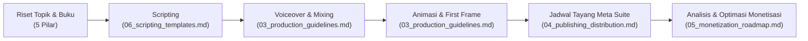

# Wealth Blueprint — Master Project Documentation

Selamat datang di pusat dokumentasi dan strategi operasional **Wealth Blueprint**, proyek media edukasi keuangan animasi yang dirancang untuk membangun audiens bernilai tinggi di Amerika Serikat (US) dan memonetisasinya melalui Facebook serta ekosistem digital multi-kanal.

---

## 📑 Struktur Dokumentasi Terkonsep

Seluruh strategi yang sebelumnya tersebar telah direstrukturisasi secara modular ke dalam dokumen-dokumen spesifik berikut:

| No | Modul Dokumentasi | Deskripsi Utama | File Link |
|---|---|---|---|
| **01** | **Brand Strategy** | Identitas merek, proposisi nilai, analisis psikografis audiens US, dan positioning pembeda. | [01_brand_strategy.md](file:///home/aris/aris/Project/content-creation/fb_pro/wealth-blueprint/01_brand_strategy.md) |
| **02** | **Content Strategy** | 5 pilar konten utama, strategi dual-track (Reels & In-Stream), serta formula konten beretensi tinggi. | [02_content_strategy.md](file:///home/aris/aris/Project/content-creation/fb_pro/wealth-blueprint/02_content_strategy.md) |
| **03** | **Production Guidelines** | Standar visual (Navy & Gold), prinsip thumbnail berdaya klik tinggi, serta SOP mixing audio & musik. | [03_production_guidelines.md](file:///home/aris/aris/Project/content-creation/fb_pro/wealth-blueprint/03_production_guidelines.md) |
| **04** | **Publishing & Distribution** | Sinkronisasi zona waktu US (EST) vs WIB, jadwal tayang mingguan, otomasi penjadwalan, dan cross-posting. | [04_publishing_distribution.md](file:///home/aris/aris/Project/content-creation/fb_pro/wealth-blueprint/04_publishing_distribution.md) |
| **05** | **Monetization Roadmap** | Syarat teknis monetisasi Facebook (600K menit & 5K followers), proyeksi RPM US, dan funnel bisnis bertahap. | [05_monetization_roadmap.md](file:///home/aris/aris/Project/content-creation/fb_pro/wealth-blueprint/05_monetization_roadmap.md) |
| **06** | **Scripting Templates & Hooks** | Formula 3-point CTA, bank 3 tipe hook, taktik viralitas Reels (loop & comment bait), dan template naskah 3 menit. | [06_scripting_templates.md](file:///home/aris/aris/Project/content-creation/fb_pro/wealth-blueprint/06_scripting_templates.md) |

---

## 🗄️ Arsip Brainstorming Mentah
Catatan diskusi mentah sebelumnya telah diarsipkan secara aman untuk referensi historis di:
* [archive/brainstorming_raw.md](file:///home/aris/aris/Project/content-creation/fb_pro/wealth-blueprint/archive/brainstorming_raw.md)

---

## 🚀 Alur Kerja Produksi Konten (Production Workflow)

